<div align="center">

# 🍆 Moupenix (The Eggplant Cursor)

**Um cursor animado e elástico em formato de Berinjela para Windows, com física dinâmica de alongamento, inércia e efeitos ao clicar.**

[](https://microsoft.com)
[](https://python.org)
[](https://pyinstaller.org)
[](https://github.com)
[](LICENSE)

<br/>

<!-- ANIMATED PREVIEW -->
<p align="center">
  
</p>

</div>

---

## 📖 Sobre o Projeto

O **Moupenix** é um aplicativo leve para Windows que substitui visualmente o ponteiro padrão do sistema por uma **Berinjela animada 🍆** ultra responsiva. 

Diferente de modificadores de cursor convencionais que usam arquivos estáticos `.cur`, o Moupenix utiliza uma camada transparente acelerada com a API nativa do Windows (`WS_EX_LAYERED | WS_EX_TRANSPARENT`), calculando física em tempo real a **60 FPS** com passagem total de cliques (click-through transparente).

> 🛡️ **Seguro e Não-Invasivo**: O aplicativo não altera arquivos de sistema do Windows. Ao fechar o programa (`ESC`), tudo volta instantaneamente ao estado original.

---

## ✨ Recursos e Ações Personalizadas

| Ação | Efeito no Cursor |
| :--- | :--- |
| 🚀 **Velocidade Dinâmica** | Conforme você move o mouse rapidamente, a berinjela se **estica** na direção do movimento e afina proporcionalmente. |
| 🤏 **Clique & Segurar (Hold)** | Ao manter o botão esquerdo pressionado (selecionar texto, arrastar janelas), ela estica, incha e pulsa com tensão. |
| 🎈 **Física de Mola (Spring Back)** | Ao soltar o clique ou parar o movimento brusco, ela retorna elasticamente ao tamanho normal com oscilação suave. |
| ✨ **Gotículas & Partículas** | Dispara pequenas gotículas/partículas com gravidade a cada clique liberado. |
| 🍮 **Inércia na Base (Jiggle)** | A base possui física de inércia independente que balança com as acelerações do mouse. |
| 🌀 **Modo Agitação (Shake Frenzy)** | Chacoalhar o mouse para os lados ativa uma oscilação elástica em onda ("efeito borracha"). |
| 💤 **Respiração Ociosa (Idle Breathing)** | Quando o mouse fica parado por alguns segundos, a berinjela "respira" suavemente. |
| 🎯 **Hotspot com 100% de Precisão** | A ponta do cursor fica fixada exatamente nas coordenadas `(X, Y)` reais, permitindo clicar normalmente em qualquer link ou botão. |

---

## 🎮 Controles e Atalhos

- **`F9`**: Abre ou oculta o **Painel de Configurações**.
- **`ESC`**: Fecha o painel ou encerra o aplicativo com segurança total.
- **Botão Esquerdo do Mouse**: Tensão, estiramento contínuo e disparo de partículas ao soltar.
- **Botão Direito**: Ações normais de contexto do Windows mantidas.

---

## 🎨 Temas Visuais Integrados

Pressione **`F9`** para alternar temas a qualquer momento:

1. **Berinjela (Eggplant)** *(Padrão público do GitHub)* — Roxo acetinado com detalhes em folha verde.
2. **Cartoon Rosa** — Rosa chiclete vibrante estilo desenho animado.
3. **Tom de Pele** — Estilo cartoon clássico com contornos definidos.
4. **Dourado Luxo (Gold Edition)** — Ouro metálico brilhante.
5. **Cyber Neon** — Ciano e magenta cyberpunk com alto contraste.
6. **Alien Verde** — Verde fluorescente extraterrestre.

---

## 🚀 Como Usar

### Opção 1: Executável Portátil (`.exe`) — *Sem necessidade de instalar nada*
1. Baixe o arquivo `Moupenix.exe` da pasta `dist/` ou das [Releases](https://github.com).
2. Dê dois cliques em **`Moupenix.exe`**.
3. Pronto! O cursor já estará ativo na sua tela.

### Opção 2: Executar via Código Python
Se preferir rodar direto pelo código-fonte:

1. Clone o repositório:
   ```bash
   git clone https://github.com/seu-usuario/moupenix.git
   cd moupenix
   ```
2. Instale a única dependência:
   ```bash
   pip install pywin32
   ```
3. Execute o script principal:
   ```bash
   python main.py
   ```
   *(ou dê dois cliques em `run.bat`)*

---

## 🔨 Como Compilar com PyInstaller

Você pode compilar o seu próprio executável standalone com um único comando:

```bash
python -m PyInstaller --onefile --noconsole --name "Moupenix" main.py
```
*(ou simplesmente execute o arquivo `build.bat`)*

O executável compilado será gerado automaticamente na pasta `dist/Moupenix.exe`.

---

## ⚙️ Opções do Painel de Controle (`F9`)

- **Escala / Tamanho Base**: Ajuste o tamanho do cursor de pequeno a gigante.
- **Alongamento por Velocidade**: Defina o quanto ele estica ao fazer movimentos rápidos.
- **Alongamento por Clique**: Defina a intensidade da tensão ao pressionar o botão esquerdo.
- **Partículas ao Soltar**: Ligue ou desligue os efeitos de partículas.
- **Som Cômico Opcional**: Som cômico de "pop" sintetizado no clique.
- **Iniciar com o Windows**: Opção para iniciar automaticamente no boot do sistema.

---

## 📜 Licença

Distribuído sob a licença **MIT**. Veja [LICENSE](LICENSE) para mais informações.
